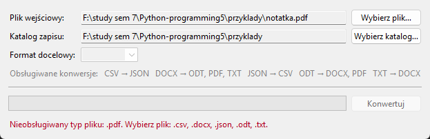
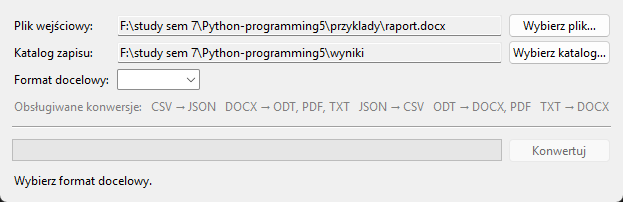
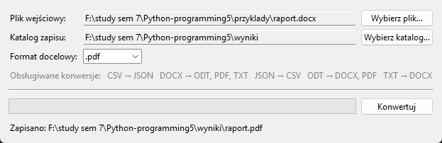
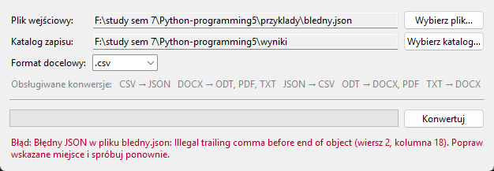

# Raport testów – Uniwersalny konwerter plików

Data: 12.11.2026 · Autor: Yevhenii Oberniak

**Środowisko:** Windows 11, Python 3.14.3 (praca) i Python 3.12 w czystym `venv` (weryfikacja instalacji), python-docx 1.2.0, LibreOffice 26.8.1.1.

## 1. Testy automatyczne

```
python -m unittest discover tests
Ran 23 tests in 16.056s
OK
```

| Plik | Testy | Co sprawdzają |
|------|-------|---------------|
| `tests/test_dane.py` | 11 | CSV ↔ JSON (polskie znaki, puste wartości, separator `;`, zagnieżdżone wartości), błędny i źle zbudowany JSON, `available_targets()`, `validate()` (brak pliku, nieobsługiwana para, puste wybory, brak prawa zapisu), bezpieczna nazwa i nadpisywanie |
| `tests/test_dokumenty.py` | 7 | TXT ↔ DOCX (akapity, tabele, polskie znaki), uszkodzony DOCX (→ TXT i → PDF), brak python-docx, brak LibreOffice, DOCX → PDF / ODT → DOCX przez LibreOffice |
| `tests/test_gui.py` | 5 | logika okna: blokada przycisku bez wyborów, zablokowana lista formatów dla nieobsługiwanego pliku, formaty zależne od rozszerzenia, blokada kontrolek w trakcie konwersji |

Bez LibreOffice (`KONWERTER_SOFFICE` ustawione na nieistniejący plik) wynik to `OK (skipped=1)` – pomijany jest tylko test wymagający LibreOffice.

## 2. Minimalna macierz testów

| Przypadek | Jak sprawdzono | Wynik | Dowód |
|-----------|----------------|-------|-------|
| **Poprawny plik w każdej grupie** | A: `osoby.csv` → JSON → CSV · B: `notatka.txt` → DOCX → TXT · C: `raport.docx` → PDF oraz → ODT → DOCX → TXT | ✅ pliki otwierają się; powrót do formatu wejściowego daje identyczną treść (A, B); PDF zaczyna się od `%PDF-`, tekst z ODT zawiera polskie znaki (C) | `test_csv_json_csv_round_trip`, `test_txt_docx_txt_keeps_paragraphs_and_polish_chars`, `test_docx_pdf_and_odt_round_trip`; zrzut 3 |
| **Błędny lub uszkodzony plik** | `bledny.json` (przecinek przed `}`), JSON będący obiektem zamiast tablicy, `uszkodzony.docx` (tekst z rozszerzeniem `.docx`) → TXT i → PDF | ✅ brak awarii; komunikat z przyczyną i dalszym krokiem; plik wynikowy nie powstaje | `test_bad_json_gives_message_and_no_file`, `test_wrong_json_structure`, `test_corrupted_docx`, `test_corrupted_docx_to_pdf`; zrzut 4 |
| **Nieobsługiwana para** | GUI: wybór `notatka.pdf` i `raport.docx`; CLI: `osoby.csv` → `pdf` | ✅ GUI: dla `.pdf` lista formatów i przycisk są zablokowane, dla `.docx` lista zawiera tylko ODT, PDF, TXT; CLI: `Nieobsługiwana konwersja .csv → .pdf. Wybierz jeden z formatów: .json.` – konwersja nie jest uruchamiana | `test_unsupported_file_blocks_format_and_button`, `test_formats_depend_on_extension`, `test_validate`; zrzuty 1–2 |
| **Brak LibreOffice / biblioteki** | zmiana konfiguracji: `KONWERTER_SOFFICE` na nieistniejący plik; python-docx: usunięta z `sys.modules` w teście oraz uruchomienie na Pythonie 3.12 bez tej biblioteki | ✅ kontrolowany błąd z instrukcją (`Zainstaluj LibreOffice (https://www.libreoffice.org/download/) albo ustaw zmienną środowiskową KONWERTER_SOFFICE…`, `Zainstaluj ją poleceniem: python -m pip install -r requirements.txt`); pozostałe konwersje i okno działają | `test_missing_libreoffice_is_reported`, `test_missing_python_docx_is_reported` |
| **Plik docelowy już istnieje** | GUI: druga konwersja tego samego pliku; CLI: dwie konwersje z rzędu | ✅ GUI pyta: Tak – nadpisz, Nie – `osoby (1).json`, Anuluj – nic nie zapisuje (wszystkie trzy odpowiedzi sprawdzone skryptem); CLI zawsze zapisuje pod bezpieczną nazwą | `test_does_not_overwrite`, `test_overwrite_when_confirmed`; demonstracja w GUI (sekcja 4) |
| **Polskie znaki i puste wartości** | `osoby.csv` (Zażółć, Gęślą, Łódź, puste `miasto`/`uwagi`, cudzysłów, nowa linia w polu), `produkty.json` (`null`, brak klucza), `notatka.txt` | ✅ znaki i struktura bez zmian; pusta komórka ↔ `""`, `null` → pusta komórka | `test_csv_json_csv_round_trip`, `test_json_union_of_keys_null_and_nested`, `test_semicolon_csv_gives_same_json` |

Dodatkowo: brak prawa zapisu do katalogu (`test_validate_not_writable_dir`) i puste wybory (`test_validate_empty_choices`) dają komunikat przed rozpoczęciem konwersji.

## 3. Uruchomienie według README na czystym środowisku

Kopia samych plików z repozytorium (bez `.venv`, logów i wyników) w nowym katalogu, Python 3.12 bez zainstalowanych pakietów, kroki z sekcji „Instalacja”:

```
python -m venv .venv
python -m pip install -r requirements.txt      → python-docx 1.2.0, lxml 6.1.3
python -m unittest discover tests              → Ran 23 tests, OK
python main.py przyklady/osoby.csv json -o wyniki      → Zapisano: wyniki\osoby.json
python main.py przyklady/raport.docx pdf -o wyniki     → Zapisano: wyniki\raport.pdf
python main.py przyklady/notatka.txt docx -o wyniki    → Zapisano: wyniki\notatka.docx
```

Wynik: ✅ projekt uruchamia się według README. Nie testowano na Linuksie ani macOS.

## 4. Scenariusz demonstracji w GUI

1. `python main.py` → **Wybierz plik…** → `przyklady/notatka.pdf`: lista formatów i **Konwertuj** zablokowane, czerwony komunikat (zrzut 1).
2. **Wybierz plik…** → `przyklady/raport.docx`: lista zawiera tylko ODT, PDF, TXT (zrzut 2) → wybierz `.pdf` → **Konwertuj**: pasek postępu, przyciski zablokowane, po ok. 5 s okno „Gotowe” (zrzut 3).
3. **Konwertuj** jeszcze raz: pytanie o nadpisanie – **Nie** tworzy `raport (1).pdf`, **Anuluj** nic nie zapisuje.
4. **Wybierz plik…** → `przyklady/bledny.json` → **Konwertuj**: okno błędu z wierszem i kolumną, czerwony status (zrzut 4).

## 5. Zrzuty ekranu

1. Nieobsługiwany typ pliku – lista formatów i przycisk zablokowane
   
2. Formaty dostępne dla DOCX – przycisk zablokowany do wyboru formatu
   
3. Udana konwersja DOCX → PDF przez LibreOffice
   
4. Błędny JSON – komunikat z przyczyną i dalszym krokiem
   
